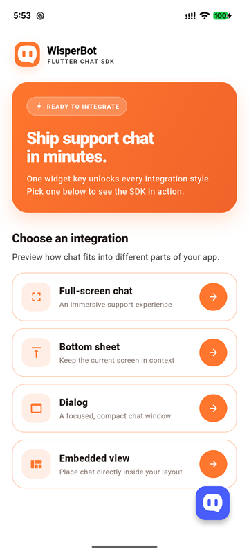
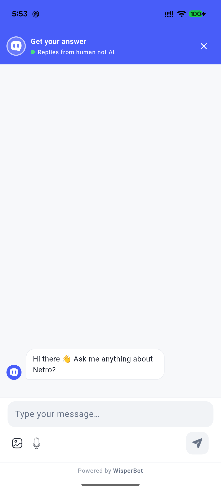
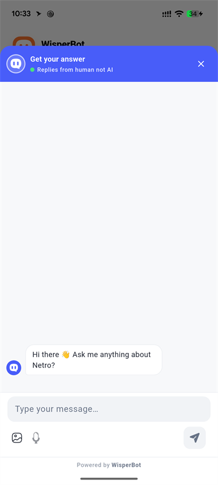
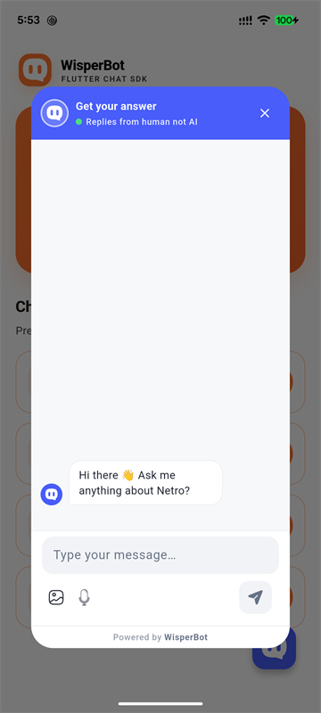
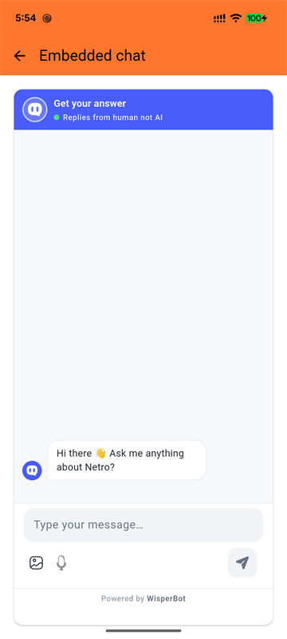

# WisperBot Chat


A customizable, battery-efficient Flutter SDK for embedding WisperBot customer support chat into mobile, web, and desktop apps. It provides identity-scoped visitor sessions, Pusher-powered real-time messaging, prebuilt customizable UI, and push notifications.

---

## Capabilities & Platform Support

| Capability | Android / iOS | Web | macOS / Windows / Linux |
|---|:---:|:---:|:---:|
| **Anonymous & Signed-User Sessions** | ✅ Yes | ✅ Yes* | ✅ Yes |
| **FCM push notifications (Android/iOS)** | ✅ Yes | ✅ Yes | ✅ Yes |
| **Text, Image & Audio Messaging** | ✅ Yes | ✅ Yes | ✅ Yes |
| **Pusher Realtime Sync** | ✅ Yes | ✅ Yes | ✅ Yes |
| **Typing Indicators & Human Handoff** | ✅ Yes | ✅ Yes | ✅ Yes |
| **Reusable Starter Questions** | ✅ Yes | ✅ Yes | ✅ Yes |
| **Prebuilt UI (Screens, Sheets, Dialogs, Launchers)** | ✅ Yes | ✅ Yes | ✅ Yes |
| **Required Pre-Chat Lead Forms** | ✅ Yes | ✅ Yes | ✅ Yes |

*\* Web secure storage requires HTTPS (or localhost during development) and is scoped to the browser origin.*

---

## Installation

Add the package to your `pubspec.yaml`:

```yaml
dependencies:
  wisperbot_chat: ^0.2.4
```

Or run:

```bash
flutter pub add wisperbot_chat
```

### Platform Requirements

* **Android**: Set `minSdk = 23` in `android/app/build.gradle` (required by `flutter_secure_storage`) and ensure `INTERNET` permission is granted:
  ```kotlin
  defaultConfig {
      minSdk = 23
  }
  ```
* **iOS & macOS**: Enable **Keychain Sharing** in Xcode and include a `keychain-access-groups` entitlement. The runnable [example](example) contains the required configuration.
* **Web**: Deploy over HTTPS (browser session storage inherits the origin's security).

---

## Quick Start

Initialize WisperBot once using your public **Widget Key**:

```dart
import 'package:flutter/material.dart';
import 'package:firebase_core/firebase_core.dart';
import 'firebase_options.dart'; // Generated by flutterfire configure.
import 'package:wisperbot_chat/wisperbot_chat.dart';

// Optional: needed only for automatic navigation from notification taps.
final navigatorKey = GlobalKey<NavigatorState>();

Future<void> main() async {
  WidgetsFlutterBinding.ensureInitialized();
  await Firebase.initializeApp(options: DefaultFirebaseOptions.currentPlatform);

  await WisperBotChat.initialize(
    widgetKey: 'YOUR_WIDGET_KEY',
    navigatorKey: navigatorKey,
  );

  // If your auth state already contains a signed-in user, call identify here
  // with its stable ID and real profile data before runApp().
  // await WisperBotChat.identify(...);

  runApp(MaterialApp(
    navigatorKey: navigatorKey,
    home: Scaffold(
      floatingActionButton: WisperBotChat.launcher(),
    ),
  ));
}
```

> [!NOTE]
> Use the **Mobile SDK key** from Widget Integrations for `widgetKey` (not the website embed key). It is a public routing identifier, not a secret. Never bundle WisperBot management credentials or widget secret keys in client applications.

---

## Integration Styles

WisperBot provides multiple ready-to-use presentation modes to fit seamlessly into any app workflow:



### 1. Full Screen
An immersive, dedicated support page with app bar navigation:

```dart
import 'package:flutter/material.dart';
import 'package:wisperbot_chat/wisperbot_chat.dart';

void openFullScreen(BuildContext context) {
  Navigator.of(context).push(
    MaterialPageRoute<void>(
      builder: (_) => WisperBotChat.screen(),
    ),
  );
}
```



### 2. Modal Bottom Sheet
Keeps the current screen in context while sliding up the chat interface:

```dart
import 'package:flutter/material.dart';
import 'package:wisperbot_chat/wisperbot_chat.dart';

Future<void> openBottomSheet(BuildContext context) async {
  await WisperBotChat.open(
    context,
    presentation: WisperBotPresentation.bottomSheet,
  );
}
```



### 3. Dialog Popup
A compact, centered chat window ideal for tablets, desktops, or web:

```dart
import 'package:flutter/material.dart';
import 'package:wisperbot_chat/wisperbot_chat.dart';

Future<void> openDialog(BuildContext context) async {
  await WisperBotChat.open(
    context,
    presentation: WisperBotPresentation.dialog,
  );
}
```



### 4. Floating Launcher
An expandable floating action button that overlays your screen:

```dart
import 'package:flutter/material.dart';
import 'package:wisperbot_chat/wisperbot_chat.dart';

Widget buildFloatingLauncher() {
  return Stack(
    children: [
      const Placeholder(), // Application content
      WisperBotChat.launcher(),
    ],
  );
}
```


When `useApiColors` is enabled, the launcher loads public dashboard widget
configuration before appearing. This is independent of
`registerVisitorOnAppLaunch`: disabling visitor registration still loads the
API color and placement without creating a visitor session.

#### Unread badges

The SDK shows, updates, and clears unread badges automatically using its
existing realtime connection. No additional backend work is required.

**Using the WisperBot launcher?** The badge is already enabled:

```dart
Scaffold(
  floatingActionButton: WisperBotChat.launcher(),
)
```

**Using your own button?** Wrap its visible widget with
`WisperBotChat.badge`:

```dart
IconButton(
  tooltip: 'Open chat',
  onPressed: () => WisperBotChat.open(context),
  icon: WisperBotChat.badge(
    child: const Icon(Icons.chat),
  ),
)
```

That is the complete setup for the common case. The wrapper accepts any widget,
keeps its original gestures and layout, and displays a dot only when unread
agent messages exist. Opening chat clears the badge after those messages are
marked read.

To show a count instead of a dot:

```dart
IconButton(
  tooltip: 'Open chat',
  onPressed: () => WisperBotChat.open(context),
  icon: WisperBotChat.badge(
    showCount: true,
    backgroundColor: Colors.pink,
    child: const Icon(Icons.chat),
  ),
)
```

The built-in launcher provides the same customization with `badge`-prefixed
parameters:

```dart
WisperBotChat.launcher(
  badgeShowCount: true,
  badgeBackgroundColor: Colors.pink,
  badgeLargeSize: 16,
  badgeOffset: const Offset(8, -8),
)
```

See the [complete unread badge guide](doc/unread-badges.md) for every option,
positioning, count shapes, custom labels, custom state handling, headless
controllers, lifecycle behavior, and troubleshooting.

### 5. Embedded View
Place the chat view directly inside an existing layout, drawer, or split-view:

```dart
import 'package:flutter/material.dart';
import 'package:wisperbot_chat/wisperbot_chat.dart';

Widget buildEmbeddedChat() {
  return WisperBotChat.view(
    showHeader: true,
  );
}
```



### 6. Headless & Custom UI
Take full programmatic control with `WisperBotChatController`:

```dart
import 'package:wisperbot_chat/wisperbot_chat.dart';

Future<void> runHeadlessChat(WisperBotUser? user) async {
  final client = WisperBotClient(
    widgetKey: 'YOUR_WIDGET_KEY',
    user: user,
  );
  final controller = WisperBotChatController(client: client);

  // Listen to state changes
  final subscription = controller.states.listen((state) {
    print('Phase: ${state.phase}, Messages: ${state.messages.length}');
  });

  await controller.initialize();
  await controller.sendText('Hello, I need help!');

  // Cleanup
  await subscription.cancel();
  await controller.dispose();
  await client.close();
}
```

---

## Configuration Reference

`WisperBotChat.initialize` accepts the following configuration options:

| Property | Type | Default | Description |
|---|---|---|---|
| `widgetKey` | `String` | *(required)* | Public Mobile SDK key issued in Widget Integrations. |
| `apiBaseUrl` | `String` | `'https://wisperbot.com'` | Base origin for widget API and public launcher-configuration requests. |
| `theme` | `WisperBotThemeData?` | `null` | Presentation overrides for colors, bubble radius, spacing, and brightness. |
| `useApiColors` | `bool` | `true` | When true, applies the dashboard-configured branding palette automatically. |
| `lightStatusBarIcons` | `bool` | `false` | Uses white status-bar icons and text in full-screen chat. Enable it for dark or strongly colored headers. |
| `presentation` | `WisperBotPresentation` | `WisperBotPresentation.fullScreen` | Default modal style (`fullScreen`, `bottomSheet`, or `dialog`) used by `WisperBotChat.open`. |
| `enableTyping` | `bool` | `true` | Whether the controller publishes throttled visitor typing updates. |
| `mediaAdapter` | `WisperBotMediaAdapter?` | `null` | Optional bridge for image selection and voice recording plugins. |
| `diagnostics` | `WisperBotDiagnosticsCallback?` | `null` | Callback receiving redacted operational metrics and lifecycle events. |
| `enablePushNotifications` | `bool` | `true` | Whether FCM tokens are registered using the host app’s default Firebase app (Android/iOS). |
| `requireNotificationPermission` | `bool` | `true` | Requires notification permission when chat is opened on Android or iOS. It does not block launch-time visitor registration. |
| `registerVisitorOnAppLaunch` | `bool` | `true` | Registers visitor presence after the first app frame without requesting notification permission. When false, registration waits until chat opens. |
| `sessionStore` | `WisperBotSessionStore?` | `null` | Optional custom storage for identity-scoped session credentials. |
| `navigatorKey` | `GlobalKey<NavigatorState>?` | `null` | Enables automatic chat navigation when a push notification is tapped. Use the same key on your `MaterialApp` or `CupertinoApp`. |
| `onNotificationTapped` | `void Function(Map<String, dynamic>)?` | `null` | Optional callback that intercepts notification taps instead of automatic navigation. |
| `onForegroundNotification` | `void Function(Map<String, dynamic>)?` | `null` | Optional callback for notifications received while the app is in the foreground. |

---

## Migrating from 0.1.x

| Before | 0.2.0 |
|---|---|
| `WisperBotChat.initializeNotificationHandlers(...)` | `await WisperBotChat.initialize(...)` |
| `WisperBotChat.registerVisitor(...)` | Set `registerVisitorOnAppLaunch` (defaults to `true`) |
| `WisperBotConfig(user: user)` | Pass options to `initialize()`, then call `identify(user)` |
| `WisperBotLocation(...)` | Removed; use generic `customFields` only when required |
| Constructing or forwarding `WisperBotConfig` | Pass options directly to `initialize()` |

For advanced headless or multi-runtime applications, construct
`WisperBotClient` directly and provide its controller to a prebuilt widget.

---

## Key Features

### 🔗 Message Links

The prebuilt chat UI keeps message text selectable and makes `http://`,
`https://`, and `www.` links tappable. Links are underlined and opened through
the platform's external URL handler; `www.` addresses use HTTPS. Trailing
punctuation is excluded from the link target. If opening fails, the chat shows
"Could not open link."

---

### 👤 Authenticated Users
Identity changes wait for an already-running session request to finish saving in its original guest/account scope, then restore the requested user ID. Await `identify(...)` before opening chat after login. A delayed guest response cannot replace account history, and repeated identification of the same user does not cancel initialization.

To associate chat history with a registered user, call `identify` after
initialization. Normal integrations send only the stable user ID and mutable
profile fields:

```dart
import 'package:wisperbot_chat/wisperbot_chat.dart';

await WisperBotChat.identify(
  const WisperBotUser(
    userId: '48291',
    name: 'Jane Doe',
    email: 'jane@example.com',
  ),
);
```

Use `userId` as the stable identity. The legacy `externalId` parameter remains
available as a compatibility alias. Names, email addresses, avatars, and
custom fields are profile attributes and can change. Do not call `identify`
with placeholder or randomly generated profile data: each distinct identity can
create a separate visitor in the dashboard.

For a guest, pass only the name when you have it:

```dart
await WisperBotChat.identify(
  const WisperBotUser(name: 'Guest User'),
);
```

Guest history survives normal app restarts on the same installation. An
uninstall/reinstall starts a new guest history. Logged-in users recover their
server history after reinstall or on another device through `userId`.

#### Optional advanced identity verification

HMAC verification is disabled by default, so no signature or backend identity
endpoint is required. If the widget owner explicitly enables verification,
generate the existing HMAC on a trusted backend and pass it as `signature`.
Unsigned or invalid user IDs are not trusted while that setting is enabled.

If the real profile is available before `runApp`, identify it after
`initialize` and before `runApp`; this cancels pending anonymous registration.
If the profile loads later, use `registerVisitorOnAppLaunch: false`, then call
`identify` when the profile arrives. The launcher still loads API colors and
placement, while the visitor session remains deferred until chat opens.

#### Switching Accounts & Logout

* **Switch user**: Call `WisperBotChat.identify(newUser)` after the host application's authenticated user changes.
* **Application logout**: Switch to a name-only guest:

  ```dart
  await WisperBotChat.identify(
    const WisperBotUser(name: 'Guest'),
  );
  ```

  The SDK restores the installation-bound guest history and preserves the previous account's isolated history for a later login.
* **Headless runtime**: Pass `user` to `WisperBotClient`, or call `controller.updateUser`, when managing an explicit controller.
* **App shutdown**: Call `WisperBotChat.shutdown()` only when permanently tearing down or reconfiguring the shared SDK runtime. It disposes resources without deleting persisted session credentials.

---

### 🎨 Colors & Theming
By default, the SDK uses the color palette configured in your WisperBot dashboard (`useApiColors: true`). 

To customize colors locally or use custom themes:

```dart
import 'package:flutter/material.dart';
import 'package:wisperbot_chat/wisperbot_chat.dart';

await WisperBotChat.initialize(
  widgetKey: 'YOUR_WIDGET_KEY',
  useApiColors: false, // Disables server palette
  lightStatusBarIcons: true, // White status-bar content in full-screen chat
  theme: const WisperBotThemeData(
    primaryColor: Color(0xFF087F5B),
    visitorBubbleColor: Color(0xFF087F5B),
    agentBubbleColor: Color(0xFFE9ECEF),
    borderRadius: 16.0,
  ),
);
```

`lightStatusBarIcons` affects full-screen chat only. Leave it `false` for dark
status-bar content on light headers. Set it to `true` for white status-bar
content on dark or strongly colored headers.

---

### 🔔 Push Notifications

Android/iOS push uses the host app's default Firebase app. Configure the app with
FlutterFire, initialize Firebase yourself, and upload that project's service account
JSON in **Widget Integrations → Mobile app → Firebase push notifications**.
The SDK never receives a service account or initializes/replaces a Firebase app.

Use the **Mobile app SDK key**, rather than the website embed key, for
`widgetKey`. A website key can start chat but push registration rejects it with
HTTP 403. Registration results are available through the redacted `diagnostics`
callback as `WisperBotDiagnosticKind.push`; failed registrations also log a safe
message in debug builds. OS notification display should be tested with the app
backgrounded; foreground banners use `onForegroundNotification`.

```dart
import 'package:firebase_core/firebase_core.dart';
import 'package:flutter/material.dart';
import 'package:wisperbot_chat/wisperbot_chat.dart';
import 'firebase_options.dart'; // Generated by flutterfire configure.

final navigatorKey = GlobalKey<NavigatorState>();

Future<void> main() async {
  WidgetsFlutterBinding.ensureInitialized();
  await Firebase.initializeApp(options: DefaultFirebaseOptions.currentPlatform);
  await WisperBotChat.initialize(
    widgetKey: 'YOUR_WIDGET_KEY',
    enablePushNotifications: true,
    requireNotificationPermission: true,
    navigatorKey: navigatorKey,
  );
  // Identify the signed-in user before displaying the app when available.
  runApp(MaterialApp(navigatorKey: navigatorKey, home: const Scaffold()));
}
```

The SDK registers the FCM token with the authenticated visitor session, updates it
on token refresh, retries temporary failures while foregrounded and on resume, and
revokes only its own association on logout/reset/account switches. It never deletes
the host's token, changes Firebase auto-init, subscribes to global topics, installs a
background handler, or changes the host's foreground presentation settings.
Server revocation requires connectivity; failed revocations are stored securely and retried on resume or the next SDK session.
Already queued or displayed OS notifications cannot be recalled.

**Permission behavior is unchanged:** `requireNotificationPermission` defaults to
`true`. Opening chat requests permission if the OS permits it; denied permission
blocks chat and permanent denial offers notification settings. Eager launch visitor
registration never prompts. Set both `enablePushNotifications: false` and
`requireNotificationPermission: false` for chat without push (including web/desktop).

Only payloads marked `source: wisperbot`, `type: widget_message`, and matching the
widget key and active visitor are accepted. Background/terminated notifications
include both notification and data payloads; the OS displays them and the SDK handles
taps automatically. `onNotificationTapped` overrides navigation. Foreground pushes
are passed to `onForegroundNotification`; foreground banners remain host-owned.

**Sharing startup routing with the host:** Firebase's `getInitialMessage()` consumes
the startup message once. When WisperBot reads it automatically (the default), host
routing must use `WisperBotChat.getInitialNotification()` to read the same cached
message. Alternatively set `handleInitialNotification: false`, keep the host's own
`getInitialMessage()` call, and forward its result to
`WisperBotChat.handleNotificationTap(message)`. It returns false for other widgets or
host messages. Background `onMessageOpenedApp` is a broadcast stream and is safe to
share; forwarding the same WisperBot message twice is deduplicated by message ID.

Android apps need `android.permission.POST_NOTIFICATIONS` and their Firebase native
configuration. iOS apps need Firebase configuration, Push Notifications capability,
Remote notifications background mode, and an APNs key uploaded to the same Firebase
project. Permission checks on iOS use Firebase directly; no permission-handler iOS
notification macro is required. The SDK accepts Firebase Core 3/Messaging 15 and Core 4/Messaging 16.
Core 4 requires iOS 15; hosts retaining iOS 13/14 should select Core 3/Messaging 15.
Firebase Core 5/Messaging 17 use a different registration API and are not included in this migration.

This is a breaking replacement for `oneSignalAppId` / `enableOneSignal`. Old OneSignal
subscription IDs cannot be reused as FCM tokens. The backend keeps legacy OneSignal
and FCM delivery side by side; the upgraded SDK registers only FCM.

---

### 📷 Media & Voice Attachments
The prebuilt composer includes image picking, document picking, and voice recording
using the SDK's built-in media adapter. No custom adapter is needed:

```dart
import 'package:wisperbot_chat/wisperbot_chat.dart';

await WisperBotChat.initialize(
  widgetKey: 'YOUR_WIDGET_KEY',
);
```
The app must provide the platform permission declarations for the media features
it uses, including iOS photo-library and microphone usage descriptions. See the
[example](example) app for platform setup.

`mediaAdapter` is an optional override for apps that need custom picker or recording
behavior. Most integrations should leave it unset.

---

### 📝 Pre-Chat Forms
When a widget requires pre-chat information (such as name or email), the built-in UI collects and submits the required fields automatically before initiating chat.

For headless integrations, submit manually via:
```dart
import 'package:wisperbot_chat/wisperbot_chat.dart';

Future<void> submitLead(WisperBotChatController controller) async {
  await controller.submitPreChat(
    const WisperBotPreChatData(name: 'Jane Doe', email: 'jane@example.com'),
  );
}
```

---

### 💬 Starter Questions

Configure up to five starter questions in **Widget Setup → Starter questions**.
The built-in chat UI displays them below the welcome message and keeps them
available throughout the bot conversation. No labels or answers need to be
hardcoded in the host application.

Selecting a question sends its label as a normal text message. WisperBot
returns the saved answer through realtime delivery or the immediate catch-up
refresh, including when Smart Bot/AI is disabled. Questions are disabled while
a message is sending, before required pre-chat fields are completed, and
during a waiting or connected human handoff.

Headless integrations can read the server-configured questions from controller
state and send a selected label through the normal API:

```dart
final questions = controller.state.widget?.starterQuestions ??
    const <WisperBotStarterQuestion>[];
if (questions.isNotEmpty) {
  await controller.sendText(questions.first.label);
}
```

`WisperBotStarterQuestion.id` is a stable UI key; send the label rather than
the ID. Saved answers remain server-side.

---

## Delivery & Reliability Behavior

* **Platform Security**: Visitor tokens are bearer credentials persisted via `WisperBotSessionStore` using platform-native secure storage (`flutter_secure_storage`).
* **Authoritative Confirmation**: Messages transition from `pending` to `sent` only upon server receipt and ID issuance.
* **Network Failures & Unconfirmed State**: If a request disconnects or times out before receiving a response, the message is marked `unconfirmed` rather than failed, avoiding duplicate message sends.
* **Realtime Sync**: A private Pusher channel delivers messages, typing changes, and handoff updates while chat is active, and disconnects automatically in the background or when chat is closed. Pull-to-refresh remains available as a user-triggered consistency check, and full initial history is loaded through bounded pagination; neither path runs on a timer.
* **Safe Diagnostics**: Diagnostic callbacks emit strictly redacted operational telemetry (durations, error codes, HTTP statuses) without logging PII, bearer tokens, or message content.

---

## Development & Testing

```bash
# Get dependencies
flutter pub get

# Format code
dart format --output=none --set-exit-if-changed .

# Run static analysis
flutter analyze

# Run unit tests
flutter test
```

---

## License

This project is licensed under the MIT License - see the [LICENSE](LICENSE) file for details.
